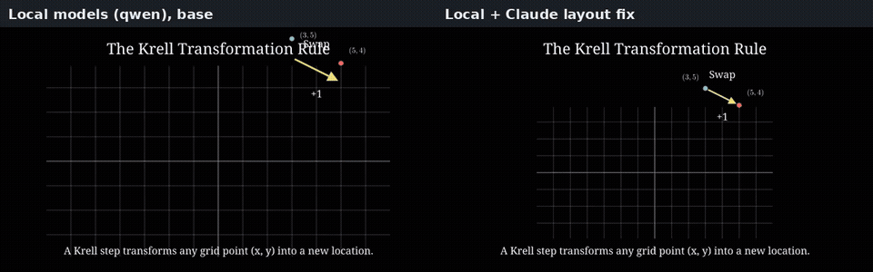
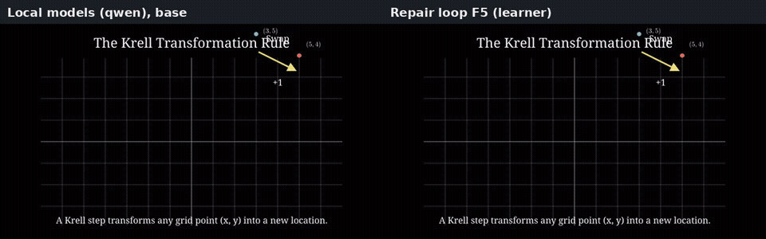
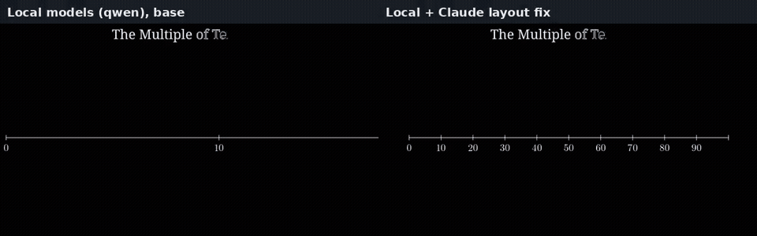
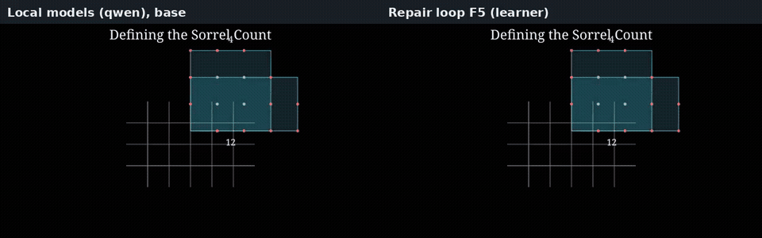

# Measuring and repairing teaching in code-generated videos: showcase

This repository holds the videos behind the paper: teaching videos written as Manim code by local models, the
versions we made of them, side-by-side comparisons, and the code of the main implementation in [`code/`](code/). Read
the PDFs in [`paper/`](paper/) for the method and statistics.

- [`paper/paper.pdf`](paper/paper.pdf): the paper (12 pages)
- [`paper/report.pdf`](paper/report.pdf): the technical report (18 pages)
- [`paper/long_report.pdf`](paper/long_report.pdf): the long report, with every study and its status
- [`paper/c2v-paper-latex.zip`](paper/c2v-paper-latex.zip): LaTeX sources of all three, with tables and figures (`pdflatex`, `bibtex`, `pdflatex` twice)

## What the videos show

**NOVEL-12** is a set of invented concepts, such as *Tovan sums* and *Krell steps on a grid*. The student model
cannot already know them, so any gain after watching comes from the video. We asked the student (`gemma4:26b`) 8
questions per concept without the video and again with it.

- **The videos teach.** On the 10 admitted concepts, the gain on 3 frames per section (M9) averages +42.4 points. It
  is positive on 9 of 10 concepts, which is beyond noise.
- **The student learns the video's own topic.** A concept's own video beats another concept's video by +64.4 points,
  on 10 of 10 concepts.
- **Cleaner layout did not measurably raise learning.** Claude fixed 96 visible faults in the 40 sections. Lasting
  conflicts fell from 27 to 4 and broken attachments from 13 to 4, yet the layout score (MVQS) rose only from 84.2 to
  85.6. Learning moved by +5.1 points, ahead on only 5 of 10 concepts, so the rule fixed in advance was not passed.
  With 10 concepts, the study can only detect effects of about 24 points or more.
- **The repair loop gives no gain beyond noise at any stage (F0 to F5).** The learner repair's lead over a generic
  repair of the same size was +6.1 points at F0 and +2.0 to +6.3 points at F1 to F5. The gate kept the learner
  revision on only 1 to 5 of the 10 concepts. Of the 4 revisions the F5 gate kept, 2 added lasting conflicts or
  broken attachments.

## Previews

| Layout: ours vs Claude-fixed | Repair: base vs learner repair |
|---|---|
|  |  |
|  |  |

Full-length comparisons are in [`showcase/comparisons/`](showcase/comparisons/).

## The videos

[`showcase/<concept>/`](showcase/) holds every version of that concept's video. [`index.json`](index.json) lists
which versions exist.

| File | Version |
|---|---|
| `local_base.mp4` | The pipeline's video: `qwen3.6` plans, `qwen3-coder:30b` writes the Manim code |
| `local_autofix.mp4` | The same, with our model-free timing fixes |
| `claude_layout.mp4` | The same, with layout and timing fixed by Claude Opus 5.5 (the text is unchanged) |
| `local_F0_learner.mp4` | The pilot repair loop's learner repair |
| `local_F5_learner.mp4` | The full repair loop (F5), present only where its gate kept the revision |

## Limitations

- **Small study.** There are 10 concepts with 8 questions each, so only effects of about 24 points or more are
  detectable. "No gain beyond noise" does not rule out small effects.
- **One main student.** It is `gemma4:26b`, which sees frames, not video, and has no audio. Claude Haiku and Sonnet
  agree on the main findings, but Claude also wrote the questions and the layout fixes.
- **Invented concepts are small.** Each fits on one card. The questions were written by one model and were not
  reviewed by teachers.
- **The local coder is weak.** Two of twelve NOVEL-12 videos were still incomplete after one retry.
- **The gate checks only the layout score.** It let through repairs that added layout faults.
- **The model-free checks are narrow.** The attachment check skips labels anchored to a text glyph.
- **The conflict counts in the tables predate a tracker fix.** With the fix they are 27, 27 and 4 instead of 31, 29
  and 4, and the conclusions are unchanged.

## Future work

- A repair gate that also counts conflicts, broken attachments and crowded text. It is built but not yet evaluated.
- A larger study: more concepts, and a gate that keeps more revisions.
- Stronger coders and a fixed layout. A study with Claude models as coder and Code2Video's anchor-grid layout was
  running at submission.
- Students that watch the video with audio, and open students of other families.
- A layout score that measures what a viewer can read, not box separation.
- Cheaper scoring: M9 only (3 frames per section) is implemented as an option.

## The code

[`code/`](code/) is the implementation as of the paper's results (commit `1ddc4c8` of the research repository),
with the benchmark, every result file and the per-video caches. [`code/REPRODUCE.md`](code/REPRODUCE.md) explains how
to rebuild the tables and re-run the studies, with the exact model versions.

| Path | What it does |
|---|---|
| `c2vlab/generate.py`, `pipeline.py` | Topic → plan → one Manim scene per section → rendered video |
| `c2vlab/preflight.py`, `admission.py` | Static code checks before rendering; the admission check for complete, clean videos |
| `c2vlab/scene_graph.py`, `mvqs.py`, `layout.py` | Scene graph of a section without rendering; the layout score (MVQS) and the layout repair |
| `c2vlab/attach.py`, `temporal.py` | The model-free checks: broken attachments, and text left on screen |
| `c2vlab/dvgain.py`, `teachquiz.py` | The student quizzes and the teaching measures (M1 to M9, TeachQuiz) |
| `c2vlab/feedback.py`, `stages.py` | The repair loop and its stages F0 to F5 |
| `bench/run_bench.py`, `metric_ladder.py`, `stages.py` | The benchmark runs, the metric ladder and the stage study |
| `bench/noise_model.py`, `layout_study.py`, `shift_attach.py` | The noise model, the layout study and the shift check |
| `bench/novel/` | NOVEL-12: the invented concepts' cards and questions |
| `paper/make_tables.py` | Every table and number in the paper, from the result files |

`bench/mmmc/` holds questions from Code2Video's MMMC benchmark under its MIT licence (`LICENSE-Code2Video`).

The figures in [`figures/`](figures/) are the paper's. A study of Claude models as the video coder, including
Code2Video's anchor-grid layout, was still running at submission. Its videos are not included here.
